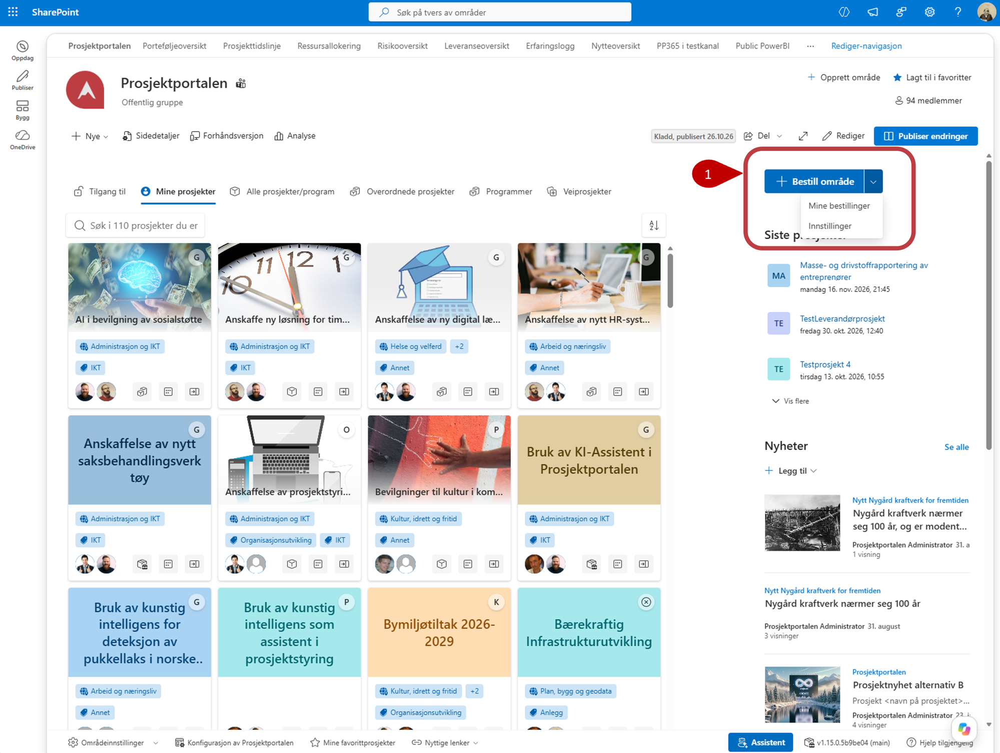
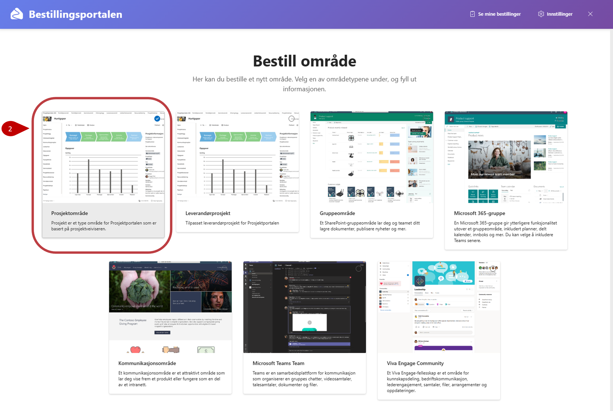
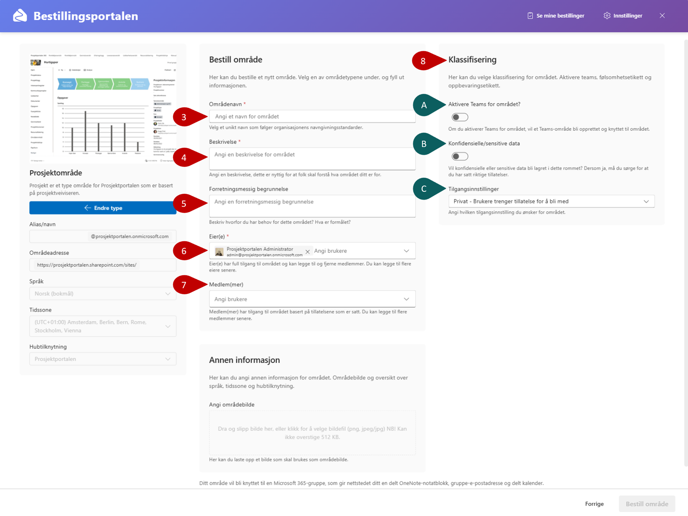
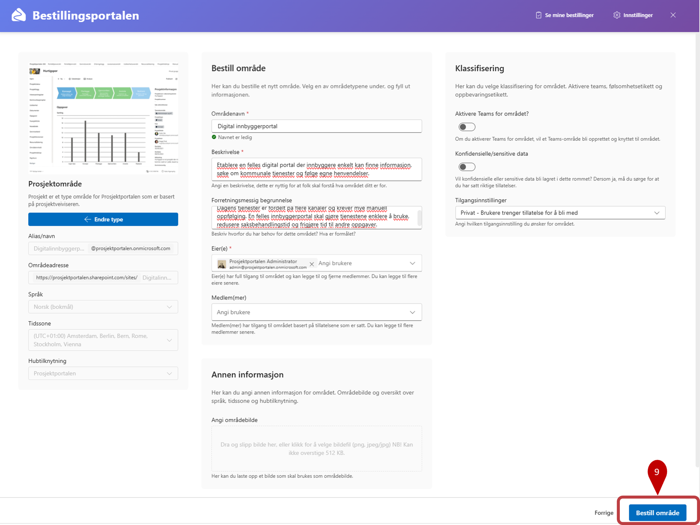
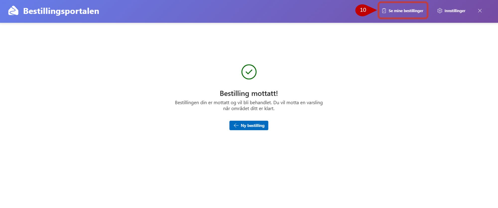
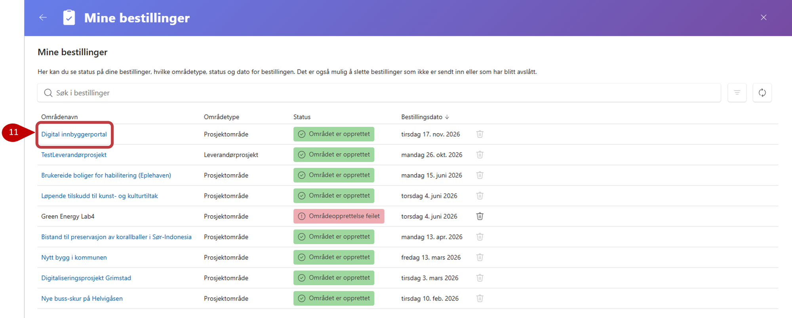
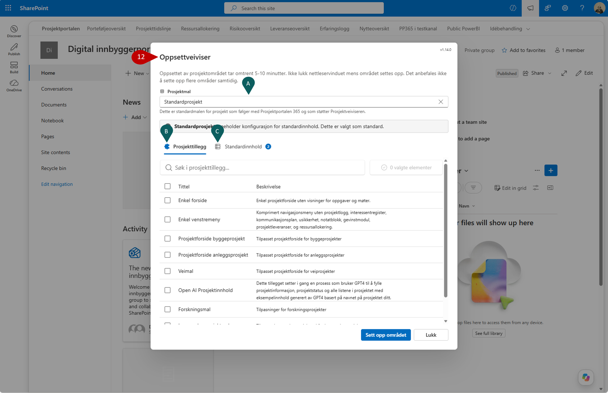
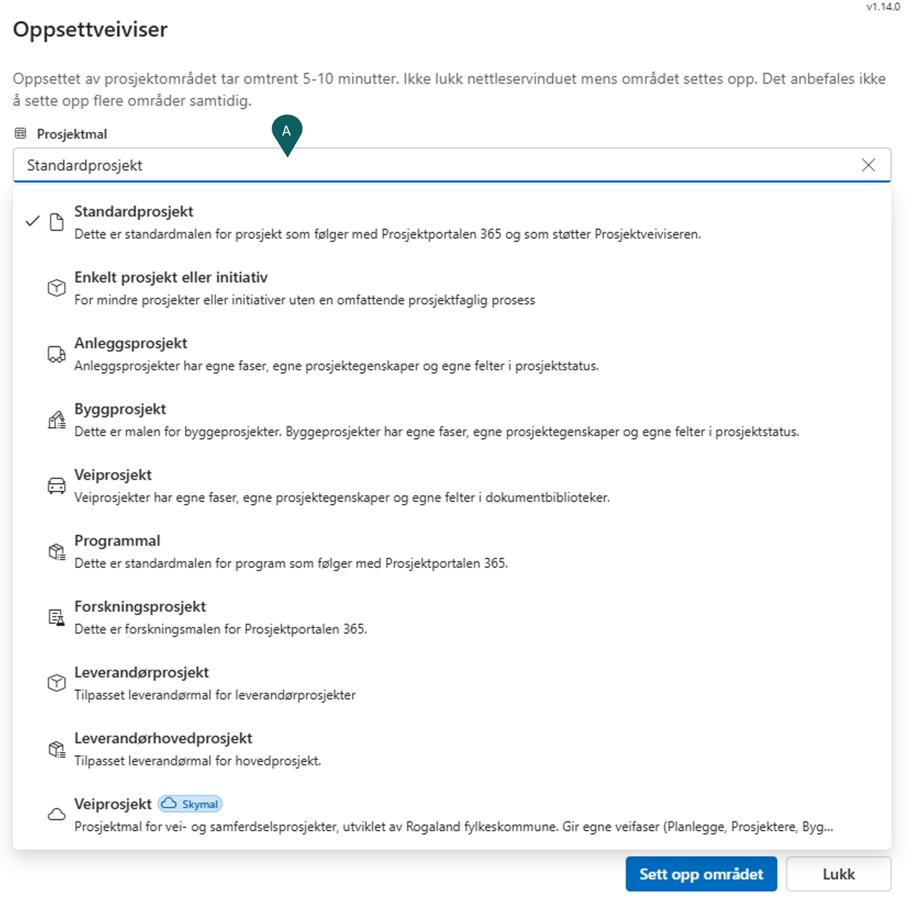
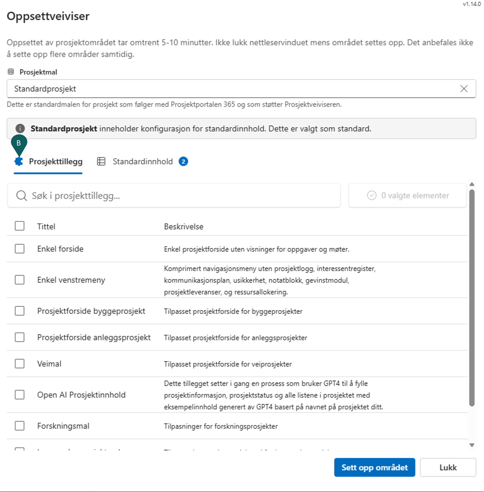
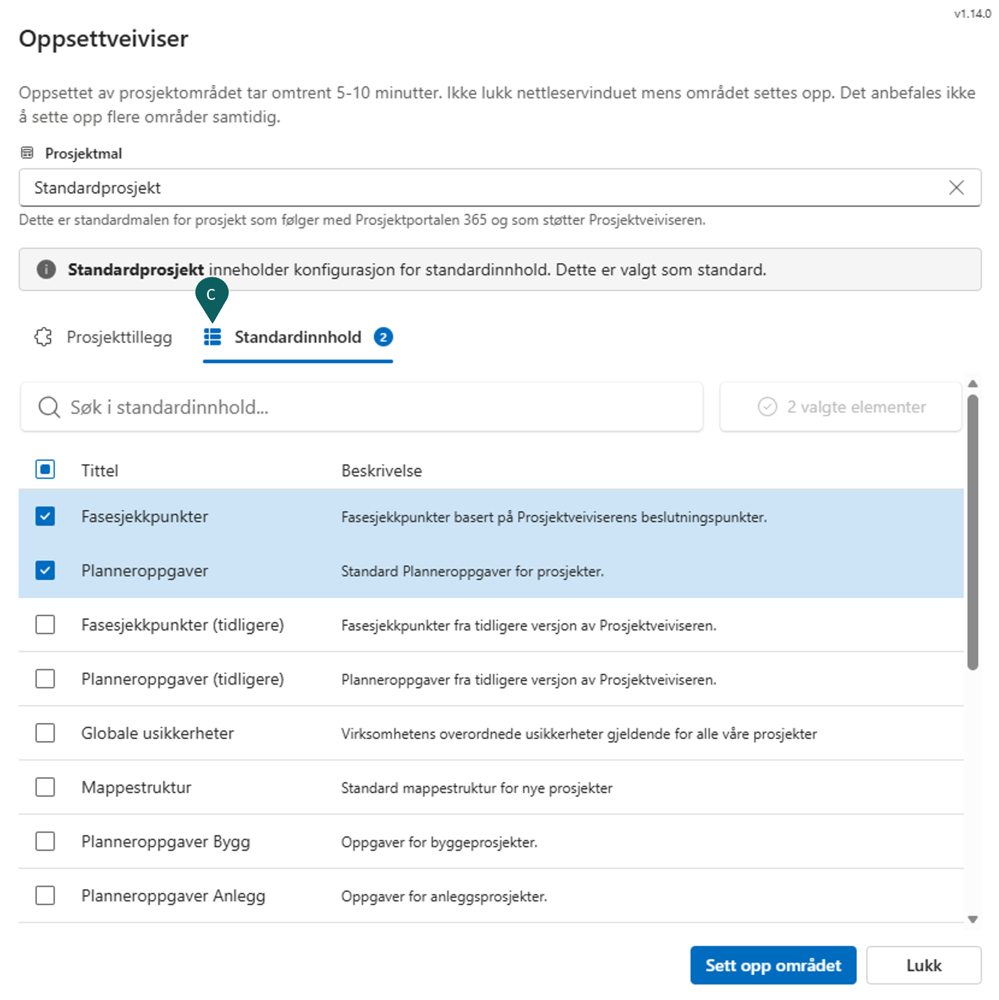

# Opprette et nytt prosjekt

Den som har *eiertilgang* på porteføljenivået, har også rettighet til å opprette nye prosjekter. 

## Åpne skjemaet

1. Dette gjøres ved å trykke på **+Bestill område**-knappen i øvre høyre del på forsiden av Prosjektportalen.

## Velg områdetype

Fra [**Bestillingsportalen**](https://www.bestillingsportalen.no/)  kan du velge å opprette en rekke type områder. Typiske valg er Prosjektområde, Microsoft Teams Team, Viva Engage Community. Listen kan inneholde andre organisasjonsspesifikke typer. Bare typer du har tilgang til og som administrator har aktivert, vises.

2. Velg **Prosjektområde** for å opprette et nytt prosjekt i Prosjektportalen.

## Fyll inn grunninformasjon

3. **Områdenavn** Gi prosjektet et unikt navn. Organisasjonen kan bruke navnekonvensjoner som automatisk legger til prefiks eller suffiks. Alias og URL beregnes mens du skriver og kan være skrivebeskyttet.
4. **Beskrivelse** Skriv en kort beskrivelse av hva prosjektet handler om.
5. **Forretningsmessig begrunnelse** Beskriv kort hvorfor prosjektet skal gjennomføres og hvilken verdi det skal gi.
6. **Eier(e)** Velg én eller flere personer som skal administrere området. Du blir normalt lagt til automatisk. En person kan ikke være både eier og medlem i samme bestilling. Organisasjonen kan også kreve et minimum antall eiere.
7. **Medlem(mer)** Personene som skal delta fra starten. Medlemmer kan også legges til senere.
8. **Klassifisering** Velg innstillinger for Teams, sensitive data og tilgang til prosjektområdet.

   A) **Aktiver Teams for området** Aktiver dersom prosjektet skal ha et tilknyttet Teams-område.

   B) **Konfidensielle/sensitive data** Angi om prosjektområdet skal inneholde konfidensielle eller sensitive data.

   C) **Tilgangsinnstillinger** Velg hvem som skal kunne få tilgang til prosjektområdet. Området blir automatisk satt som privat.

## Kontroller og send inn

Knappen for innsending er utilgjengelig til alle krav er oppfylt. Appen kontrollerer blant annet:

- at obligatoriske felt er fylt ut
- at minimum antall eiere er valgt
- at samme person ikke er både eier og medlem
- at personene finnes i SharePoint
- at URL-en eller aliaset ikke allerede er i bruk
- at det ikke finnes en aktiv bestilling med samme alias

9. Velg **Bestill område** når opplysningene er riktige.

## Følge en bestilling

En vellykket innsending betyr at bestillingen er registrert. Prosjektet opprettes ikke nødvendigvis med én gang. Vanligvis må bestillingen først godkjennes, og deretter behandles den av de automatiske provisjoneringsprosessene. Automatisk godkjenning kan være aktivert i enkelte installasjoner. 

10. Åpne **Se mine bestillinger** fra menyen i Bestillingsportalen. Du ser bestillinger du selv har opprettet eller står oppført som bestiller for.

Du kan:

- søke i bestillingene
- sortere på navn, type, status eller dato
- åpne det ferdige området når URL-en er tilgjengelig
- slette bestillinger som ikke er sendt inn, er avvist, har feilet eller gjelder et område som allerede finnes

Statuslisten oppdateres ikke nødvendigvis umiddelbart. Bakgrunnsprosessene leser normalt SharePoint-listene med omtrent ett minutts intervall, men den totale behandlingstiden varierer med områdetype, godkjenning og belastning i Microsoft 365 og Azure.

11. Når prosjektet er opprettet, kan du åpne prosjektområdet fra flere steder. Du kan gå til **Mine bestillinger** i Bestillingsportalen og åpne den ferdige bestillingen, eller finne prosjektet fra forsiden i Prosjektportalen.

## Tilpassing av prosjektet

12. Første gang du åpner prosjektet blir du bedt om å sette opp området med ønsket innhold. Innholdet er styrt av porteføljeadministrator. Videre følger en forklaring på hva du kan tilgjengeliggjøre i det nye prosjektet.

**A) Prosjektmal** - I denne nedtrekksmenyen velger du hvilken mal prosjektet skal settes opp etter. Her kan du velge mellom de ulike prosjektmalene som er installert, disse vil variere basert på deres tilpasninger og egne maler. Maler merket *Skymal* hentes fra det sentrale mallageret når prosjektet settes opp, se [Malpakkekatalog](3.11-Malpakkekatalog.html).

**B) Prosjekttillegg** - Her velger du hvilke tillegg som du ønsker at skal inkluderes i dette prosjektet.

**C) Standardinnhold** - Standardinnhold er faktiske data som kan legges til i de enkelte lister og biblioteker som finnes på prosjektområdet.

