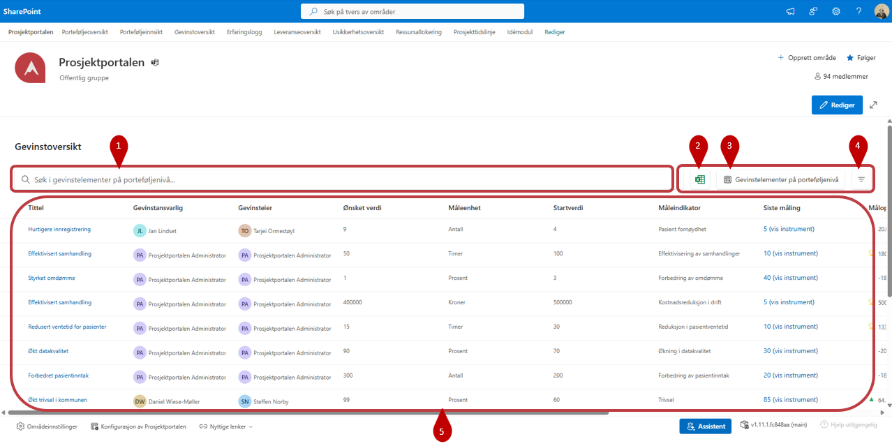
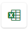
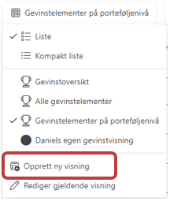
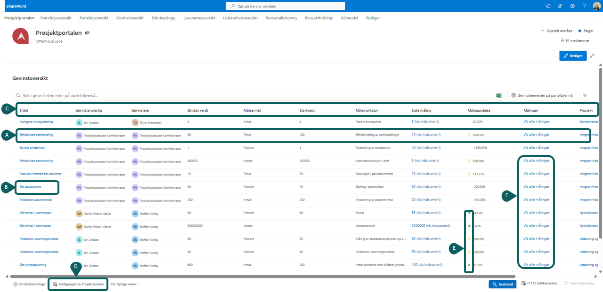
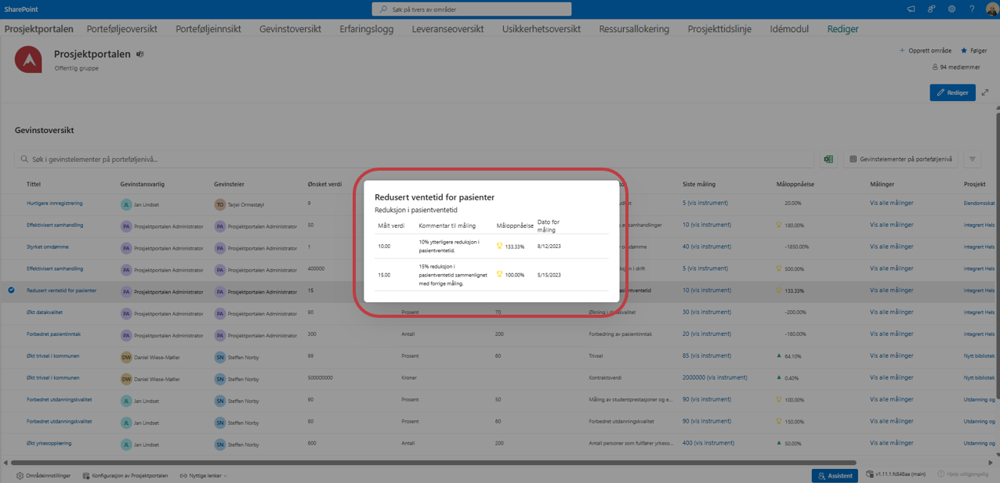

# Nytteoversikt

1. Nytteoversikten viser nyttevirkninger fra prosjektene i porteføljen.

2.  - Du kan søke, filtrere, gruppere og eksportere innholdet til Excel. Hvis oversikten er filtrert, inneholder eksporten bare elementene som vises. Tilbakestill filtrene dersom du ønsker å eksportere alle tilgjengelige nyttevirkninger.

3. Her kan du velge mellom eksisterende visninger, redigere visning og **opprette ny visning**

    

4) Med -knappen kan du filtrerere basert på tilgjengelige felter.

5)  I denne delen finner du selve oversikten

## Nytteoversikt og detaljer om nyttevirkning 
   

**A)** Hver rad representerer en nyttevirkning.

**B)** Velg tittelen for å åpne nyttevirkningen i prosjektområdet.

**C)** Velg en kolonneoverskrift for å sortere eller gruppere innholdet der dette er tilgjengelig.
      
**D)** Tilgjengelige kolonner og grupperingsvalg styres av konfigurasjonen i Prosjektportalen.

**E)** Positiv eller negativ utvikling i måloppnåelsen vises med symboler.

**F)** HVelg målingsfunksjonen på raden for å se målingene som ligger til grunn for nyttevirkningen.

