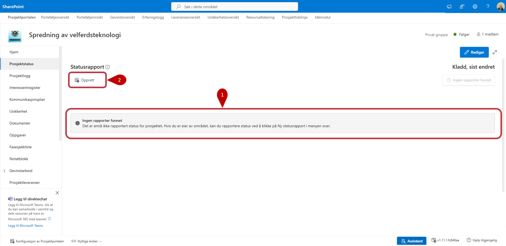
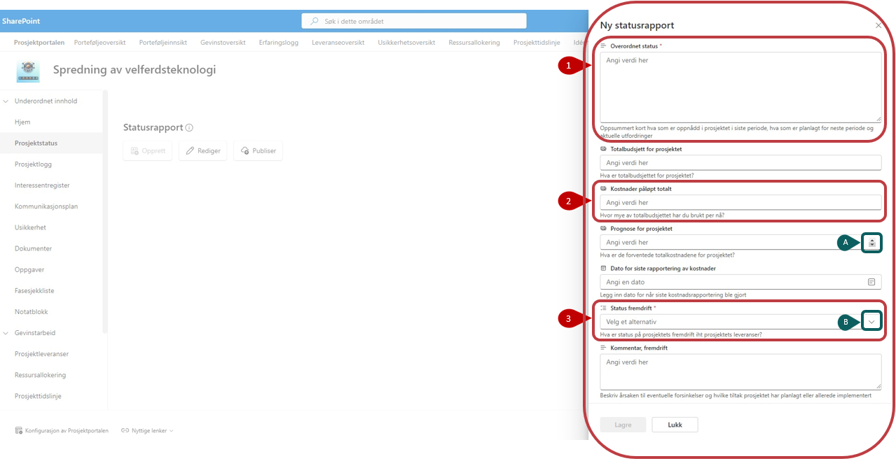
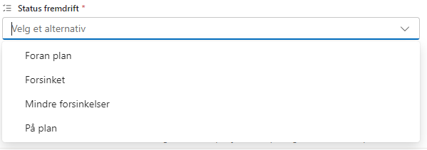
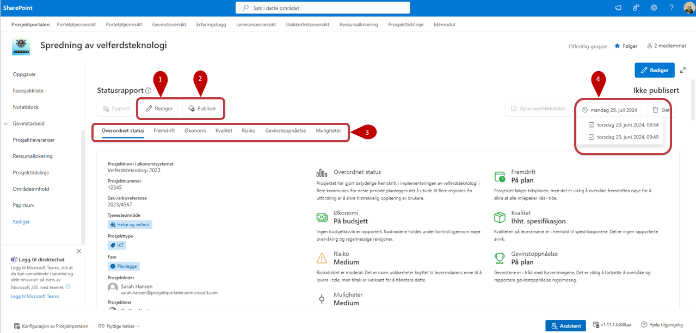
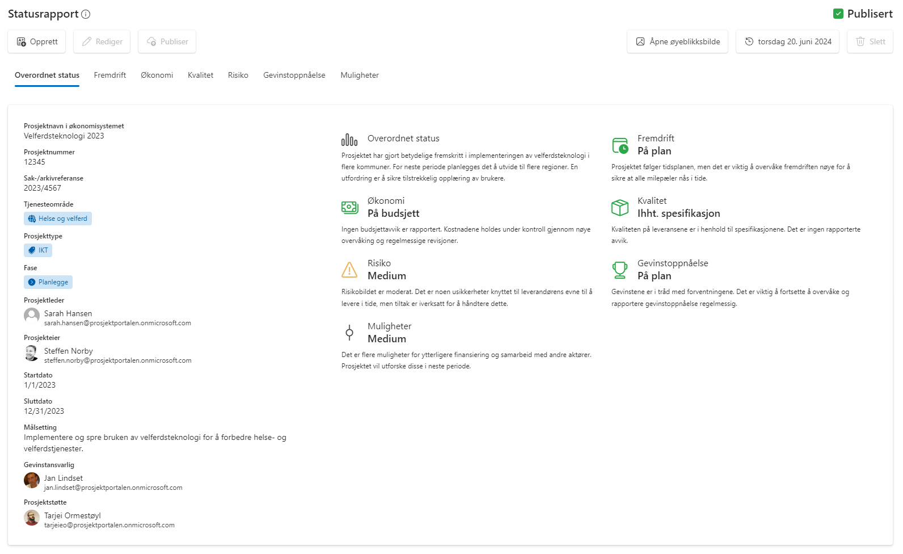
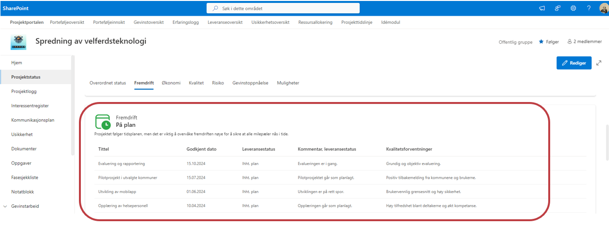
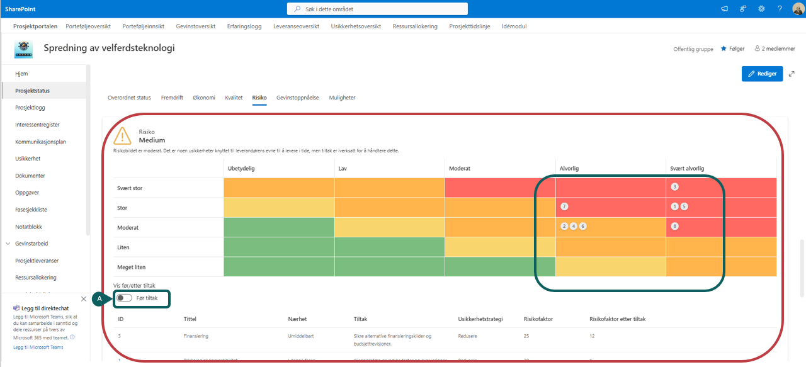
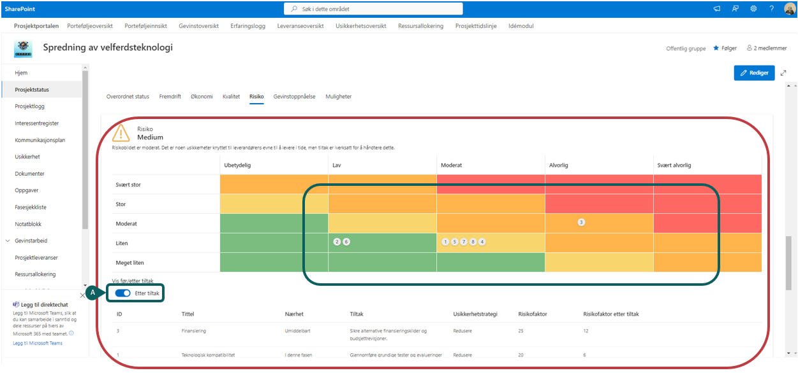

# Prosjektstatus

Prosjektstatus gir en samlet oversikt over status og fremdrift i prosjektet. Noe informasjon rapporteres direkte i statusrapporten, mens annen informasjon hentes automatisk fra prosjektet.

Oversikten gir en visuell fremstilling av prosjektets nåværende status og utvikling.

Et prosjekt kan også være satt opp med flere rapporteringsserier, for eksempel dersom prosjektet består av delprosjekter som rapporterer status hver for seg.

1. Før første statusrapport er opprettet vil vinduet se ut som bildet under.
2. For å opprette ny statusrapport klikker du på **"Opprett"**

    

## Flere rapporteringsserier

Et prosjekt kan være satt opp med flere rapporteringsserier, for eksempel dersom prosjektet består av flere delprosjekter som skal rapportere status hver for seg.

Når flere rapporteringsserier er tilgjengelige, vises en **velger øverst på statussiden**. Her velger du hvilken rapporteringsserie du vil arbeide med.

Den ordinære statusrapporteringen for prosjektet ligger i **hovedrapporteringen**. Eventuelle delprosjekter vises som egne rapporteringsserier.

**Slik rapporterer du status for et delprosjekt:**

1. Velg ønsket rapporteringsserie øverst på statussiden.
2. Velg **Opprett** for å opprette en statusrapport for den valgte serien.
3. Fyll ut statusrapporten på samme måte som en ordinær statusrapport.
4. Velg **Lagre** for å kontrollere rapporten.
5. Velg **Publiser** når rapporten er ferdig.

Tidligere statusrapporter vises for rapporteringsserien du har valgt.
NYTT SKJERMBILDE

## Opprette en statusrapport

Velg **Opprett** for å opprette en ny statusrapport.

Et redigeringspanel åpnes på høyre side med feltene som skal fylles ut. Felt som er merket med stjerne, må fylles ut før rapporten kan lagres.

Dersom prosjektet har flere rapporteringsserier, opprettes rapporten for serien som er valgt øverst på statussiden.

Rapporten innholder felt som har forskjellige verdier som:
1. **Fritekstfelt** brukes til å beskrive og utdype prosjektets status. Dette gjelder blant annet **Overordnet status** og kommentarfeltene som tilhører de ulike statusområdene.
2. **Tallverdier** brukes blant annet til økonomisk status. Du kan skrive inn verdiene direkte i feltene.

   Eksempler: 
    - **Totalbudsjett for prosjektet**
    - **Kostnader påløpt totalt**
    - **Prognose for prosjektet**
      
     
     **A.** Ved å holde muspekeren inne i feltet får du opp disse piler som lar deg legge inn tall 

4.  Statusområdene bruker **forhåndsdefinerte verdier** som gjør det enklere å gi en samlet vurdering av prosjektets status.Forhåndsdefinerte verdier. Statusrapporten kan blant annet inneholde:
    - **Status fremdrift**
    - **Status Økonomi**
    - **Status kvalitet**
    - **Status risiko** [(mer informasjon om rapporten under Usikkerhet)](https://docs.puzzlepart.com/prosjektportalen-manual/Brukermanual/4%20Prosjekt/4.6-Usikkerhet.html)
    - **Status muligheter**
    - **Status nytteoppnåelse**
    - **Status omfang**
    - **Status bærekraft**

 
    **B.** Klikke på pilen for å få se på verdiene som er tilgjengelige og er definert på forhånd
    
      

   ***For alle statusfelt er også mulig å legge til egne kommentarer der det er behov for å utdype med mer detaljer. Dette gjør du i kommentarfeltet under av hver seksjon***

## Lagre, redigere og publisere en statusrapport

Når du har fylt ut statusrapporten, velger du **Lagre**. Rapporten vises deretter i visningsmodus, slik at du kan kontrollere innholdet før den publiseres.

1. Velg **Rediger status** dersom du vil gjøre endringer.
2. Velg **Publiser** når rapporten er ferdig.

Når rapporten publiseres, blir den skrivebeskyttet, og informasjon fra rapporten blir tilgjengelig på porteføljenivå.

Det er den siste publiserte statusrapporten som brukes til å vise gjeldende prosjektstatus på porteføljenivå.

 

Tidligere statusrapporter finner du i rapportvelgeren på statussiden.

Dersom prosjektet har flere rapporteringsserier, vises tidligere rapporter for **rapporteringsserien du har valgt**.

## Statusrapporten i visningsmodus

Når du åpner Prosjektstatus fra prosjektets navigasjon, vises den valgte statusrapporten i visningsmodus.

Rapporten kombinerer informasjon som er registrert direkte i statusrapporten, med relevant informasjon som hentes fra prosjektet.

## Prosjektdata og annet dynamisk innhold i statusrapporten

Statusrapporten kan vise informasjon som hentes automatisk fra andre deler av prosjektet. Hvilket innhold som vises, avhenger av hvilke opplysninger som er registrert i prosjektet.

### Fremdrift
Informasjon om prosjektets leveranser kan vises i statusrapporten når det er registrert leveranser i prosjektet.

### Risiko
Risikoer vil også bli indikert i en risikomatrise dersom det er registrert risikoer i prosjektet. Her synliggjøres alle Usikkerheter som er registrert og har status som ***Identifisert***.

  **A)** Ved å trykke på **Vis før/etter tiltak** knappen under diagrammene kan man se en visuell representasjon av risikoer før eller etter tiltak basert på informasjon skrevet inn under usikkerheter som legges inn.

***Risikoer før tiltak***

***Risikoer etter tiltak***

