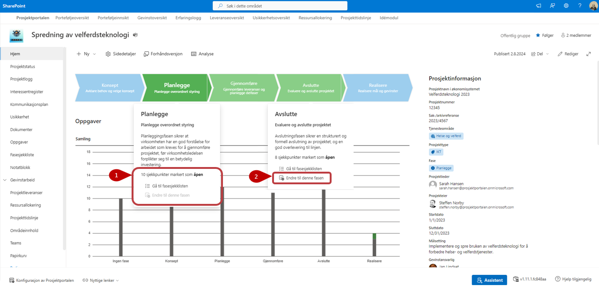
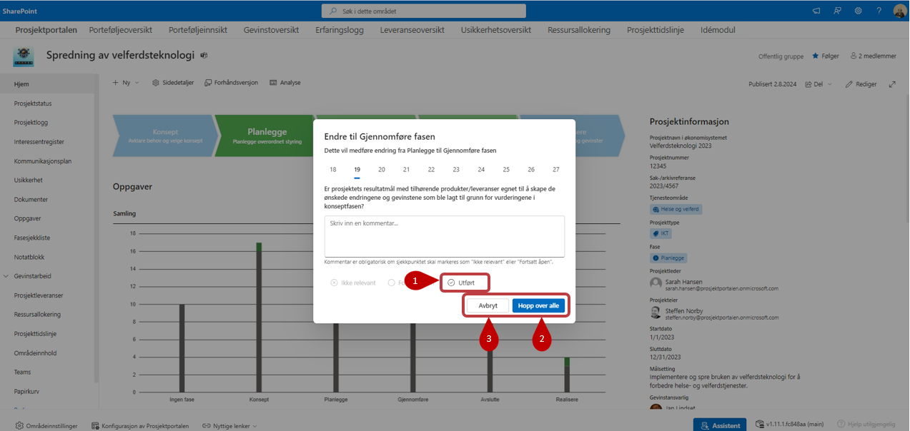
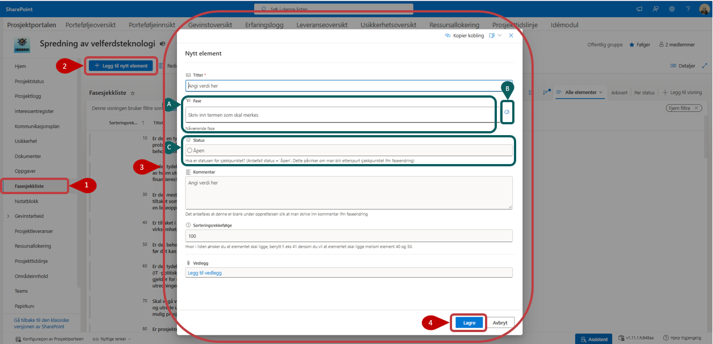
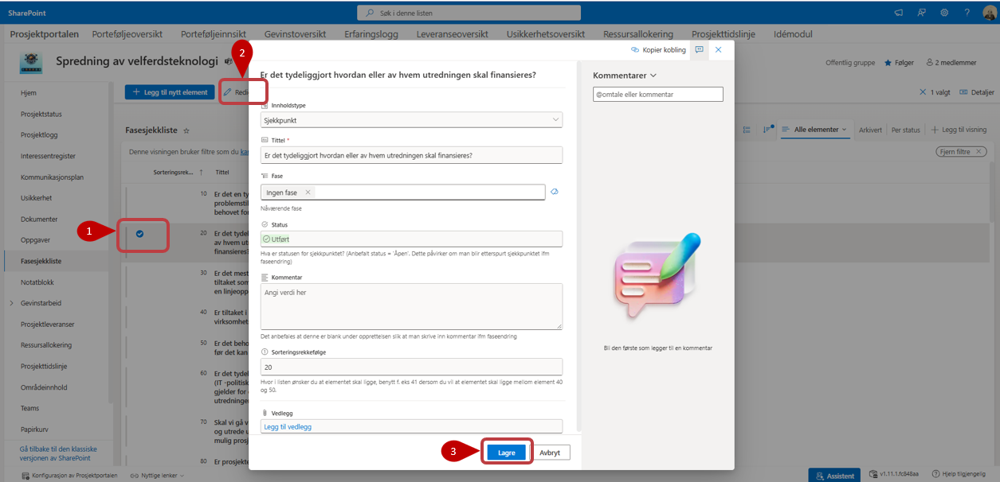

# Fasesjekkliste

## Innhold

Fasesjekklisten hjelper prosjektet med å følge opp aktiviteter og avklaringer som bør være gjennomført før prosjektet går videre til neste fase. Hvilke sjekkpunkter som er tilgjengelige, kan variere avhengig av prosjektmalen som er valgt for prosjektet.

## Gjennomgang av sjekkpunkter ved endring av fase

1. I faseviseren på forsiden av prosjektet får du en indikasjon på hvor mange sjekkpunkter som er utført i hver fase ved å klikke på fasen 

2. Når du har kommet til faseendring i prosjektet, trykker du på *Endre til denne fasen* under den nye fasen (i bildet under vil vi endre fra Planlegge-fasen til Avslutte-fasen).

Nå vil Prosjektportalen kontrollere om fasesjekkpunktene i den fasen du går fra er utført. Dersom alt er utført, vil du bli bedt om å bekrefte at du vil bytte fase.

Dersom noen av fasesjekkpunktene ikke er utført, vil en dialogboks åpne seg og du blir bedt om å besvare de gjenstående
fasesjekkpunktene og kommentere sjekkpunktene.

Du kan velge: 
1. **Utført** - da kommer du videre til neste sjekkpunkt som er åpen
2. **Hopp over alle** - Da hopper du over alle sjekkpunkter og kan velge å gå over til neste fase 
3. **Avbryt** - Lukker dialogboksen
   

## Redigere prosjektets fasesjekkpunkter

### Opprette nytt sjekkpunkt

1. Trykk på **Fasesjekkliste** i venstremenyen for å åpne den.
2. Trykk deretter på **Legg til nytt element** for å opprette et nytt fasesjekkpunkt.
3. En side åpnes opp. Fyll inn relevant innhold.

   **A)** Fase - Oppgi fasen som sjekklisten skal tilhøre
   
   **B)** Trykk på symbolen for å få opp en liste over tilgjengelige faser eller
   
   **C)** Status - La status stå som ***Åpen*** hvis det er noe som skal gjennomgås senere.
   
5. Lagre når du er ferdig

### Redigere eksisterende sjekkpunkter
Eksisterende fasesjekkpunkter kan redigeres ved å markere et enkelte element.
1. Marker sjekkpunkten du vil redigere
2. velg **Rediger** på toppen av siden over listen. 
   Rediger egenskapene på prosjektet i den nye siden som kommer opp. Husk å la et fasesjekkpunkt stå som ***Åpen*** på status dersom det er et punkt som skal bli tatt stilling til på et senere tidspunkt.
3. Lagre når du er ferdig med redigering

