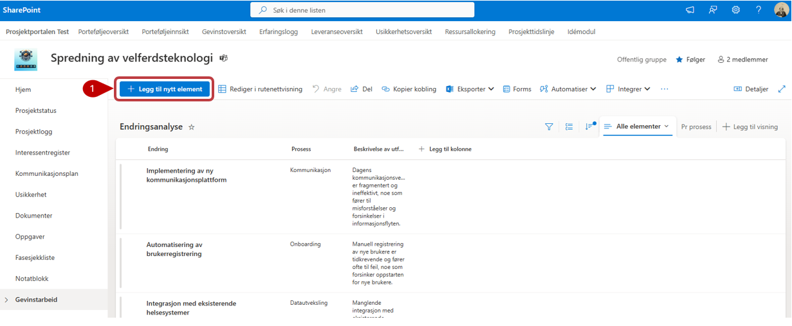
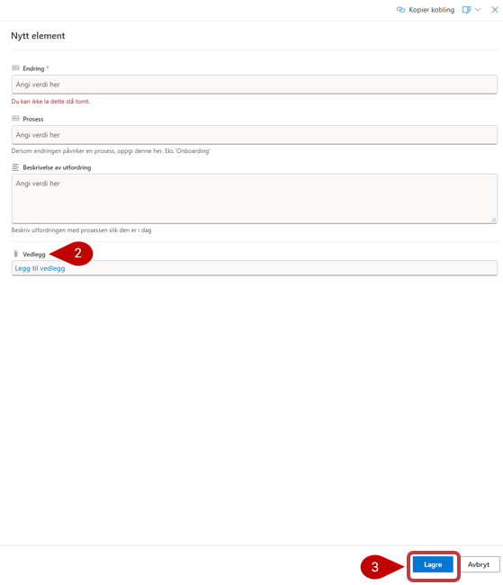

# Endringsanalyse

Endringsanalysen brukes til å identifisere og beskrive endringer i prosesser, organisasjon og arbeidsmåter. Endringene danner grunnlag for å identifisere og følge opp nyttevirkninger i **Nytteanalyse og plan for nyttestyring**.

Les under her for mer informasjon om opprettelse av ny **Endring**

Fyll ut feltene med relevant informasjon. Legg merke til at noen av feltene har en stjerne ved navnet. Disse er obligatoriske å fylle ut, og du får ikke lagret før det er gjort.
1. Trykk på **Legg til nytt element** for å opprette ny element for endringsanalyse.
2. **Vedlegg** kan legges til på enkelte elementer. Merk at disse vedleggene bare lagres i denne listen, og blir ikke vist i dokumentbiblioteket.
3. Husk å **Lagre** når du er ferdig i bunn av listen.

