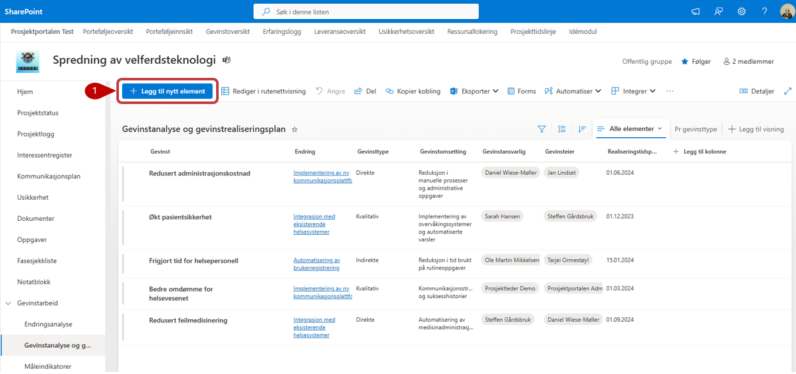
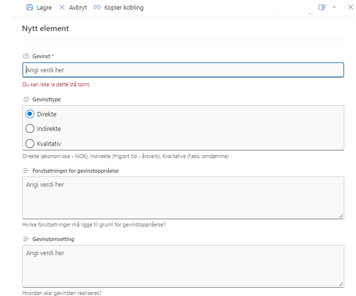
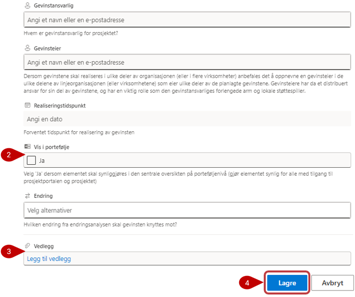

# Nytteanalyse og plan for nyttestyring

I nytteanalysen og planen for nyttestyring registreres og vurderes de forventede nyttevirkningene prosjektet skal bidra til. Nyttevirkningene kan knyttes til endringer som er registrert i endringsanalysen.

1. Velg **Legg til nytt element**, og fyll ut relevant informasjon. Felt som er merket med stjerne, må fylles ut før elementet kan lagres.
2. Nyttevirkninger som er relevante på tvers av prosjekter, kan gjøres tilgjengelige på porteføljenivå ved å sette **Vis i portefølje** til **Ja**. Informasjon fra nytteanalysen og nytteoppfølgingen blir da tilgjengelig i Nytteoversikten.
3. **Vedlegg** lagres i listen og vises ikke i prosjektets dokumentbibliotek.
4. Velg **Lagre** når du er ferdig.

