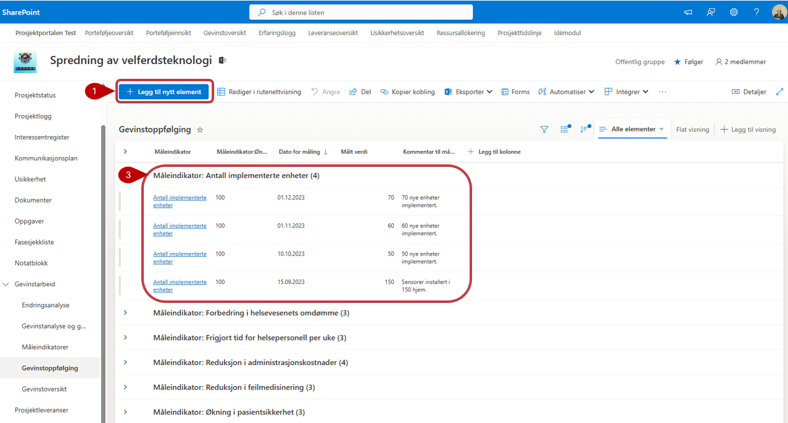
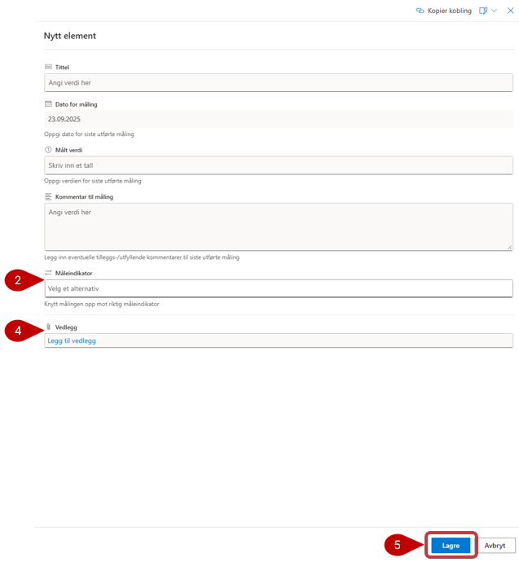

# Nytteoppfølging

Nytteoppfølging brukes til å registrere målinger og følge utviklingen i prosjektets nyttevirkninger. 

1. Velg **Legg til nytt element**, og fyll ut relevant informasjon. Felt som er merket med stjerne, må fylles ut før målingen kan lagres.
2. Når du registrerer en måling, velger du hvilken **måleindikator** målingen gjelder for. Målingene grupperes under den tilhørende måleindikatoren.
3. **Vedlegg** lagres i listen og vises ikke i prosjektets dokumentbibliotek.
4. Velg **Lagre** når du er ferdig.

Resultatene fra nytteoppfølgingen oppdateres automatisk i Nytteoversikten.

