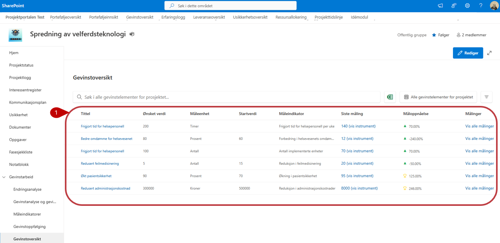
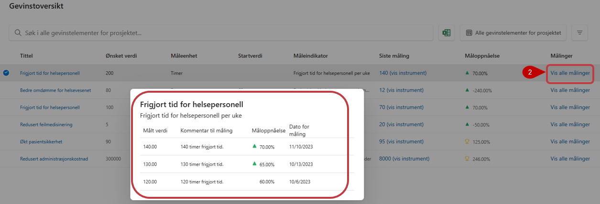
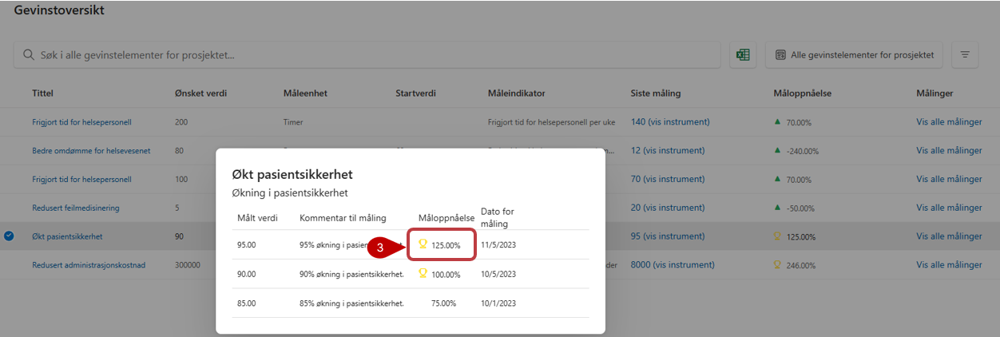

# Nytteoversikt

Nytteoversikten opprettes automatisk når det er registrert nyttevirkninger, måleindikatorer og målinger i prosjektet.

1. Oversikten viser prosjektets nyttevirkninger og utviklingen i måloppnåelsen ved hjelp av tall og symboler.

2. Velg **Vis alle målinger** for å se målingene som ligger til grunn for den enkelte nyttevirkningen.

3. Hvis måloppnåelsen er høyere enn 100 prosent, vises et pokalsymbol ved resultatet.

