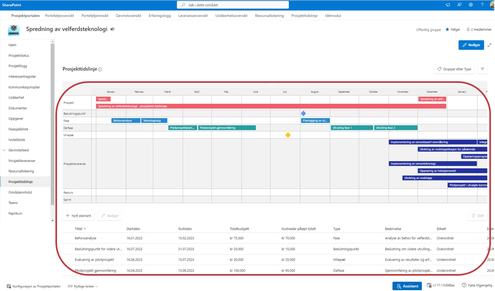
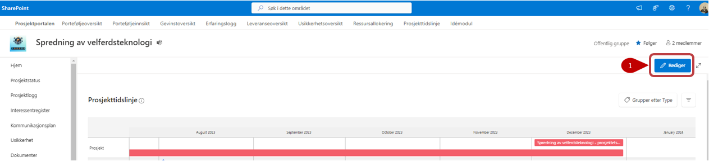
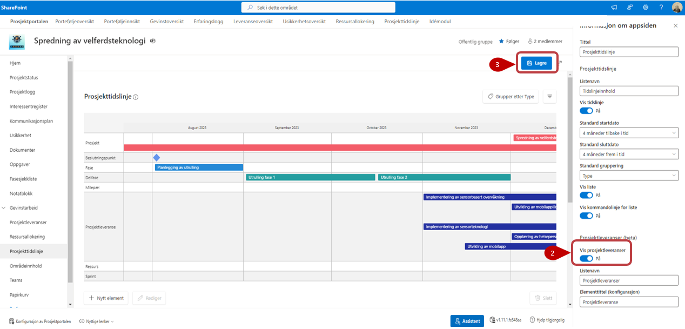
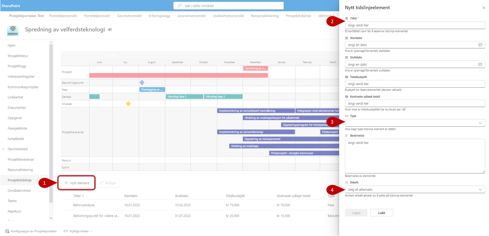
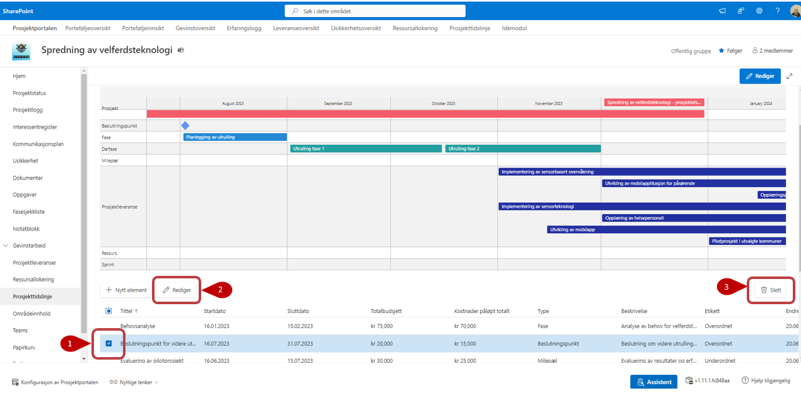
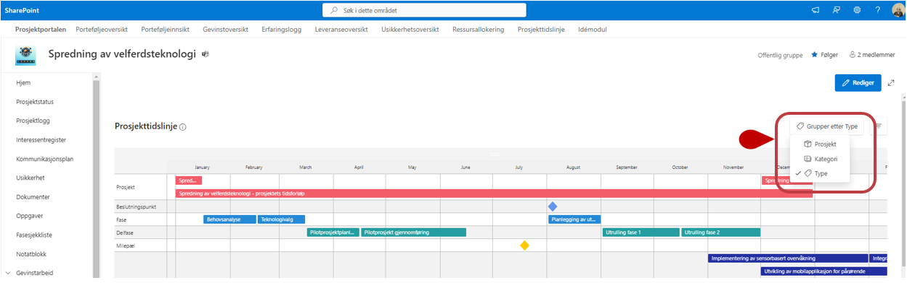
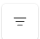
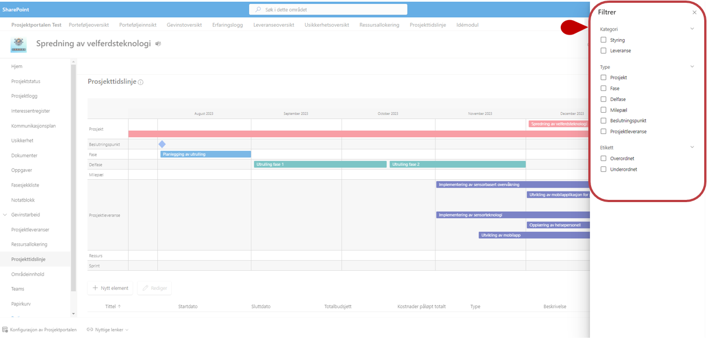

# Prosjekttidslinje

## Innhold

- [Prosjekttidslinje](#prosjekttidslinje)
  - [Innhold](#innhold)
- [Prosjekttidslinje](#prosjekttidslinje-1)
  - [Rediger egenskaper](#rediger-egenskaper)
  - [Legg til nytt element](#legg-til-nytt-element)
  - [Redigere eksisterende element](#redigere-eksisterende-element)
  - [Gruppering](#gruppering)
  - [Filtrering](#filtrering)

# Prosjekttidslinje
Prosjekttidslinjen gir en visuell oversikt over viktige aktiviteter og hendelser i prosjektet. Tidslinjen viser som standard prosjektets tidsperiode basert på prosjektets start- og sluttdato.

Innholdet i tidslinjen kan variere mellom ulike prosjektmaler. Prosjektmalen kan ha eget tidslinjeoppsett og forhåndsdefinerte tidslinjeelementer.
I tidslinjen kan du legge til og redigere elementer, gruppere og filtrere innholdet og tilpasse visningen. Endringer i tidslinjeelementene synkroniseres med tilhørende liste på porteføljenivå.

For å zoome inn/ut i tidslinje bildet bruk **ALT+Musehjul**

## Rediger egenskaper
1. Det er mulig å redigere visningen gjennom å trykke på Rediger. Da åpnes en panel på høyre siden.
2. Her kan du velge å vise frem prosjektleveranser gjennom å velge "På/Av" på bryteren.
3. Lagre endringene dine

## Legg til nytt element

1. Velg **Nytt element**. Et redigeringspanel åpnes på høyre side.
2. Fyll ut **Tittel** og annen relevant informasjon. Felt som er merket med stjerne, må fylles ut.
3. Velg **Type** for å angi hvilken type tidslinjeelement du vil opprette. Tilgjengelige typer kan blant annet være **Fase**, **Delfase**, **Milepæl**, **Beslutningspunkt**, **Ressurs** og **Sprint**. Elementtypene vises forskjellig i tidslinjen.
4. Angi **start- og sluttdato** der dette er relevant for elementtypen.
5. Velg deretter **Etikett** for å gjøre elementet enklere å finne ved filtrering.
6. Velg **Lagre**.

      
## Redigere eksisterende element 

1. Marker elementet du vil redigere.
2. Velg **Rediger**. Redigeringspanelet åpnes på høyre side.
3. Gjør ønskede endringer og velg **Lagre**.
   
Velg **Slett** dersom elementet skal fjernes fra tidslinjen.

 
## Gruppering

Du kan velge å gruppere visningen med disse grupperingsvalgene:

- Prosjekt
- Kategori
- Type

## Filtrering

Visningen kan filtreres gjennom å trykke på -knappen. Her kan man filtrere på:
- Kategori
- Type
- Etikett

